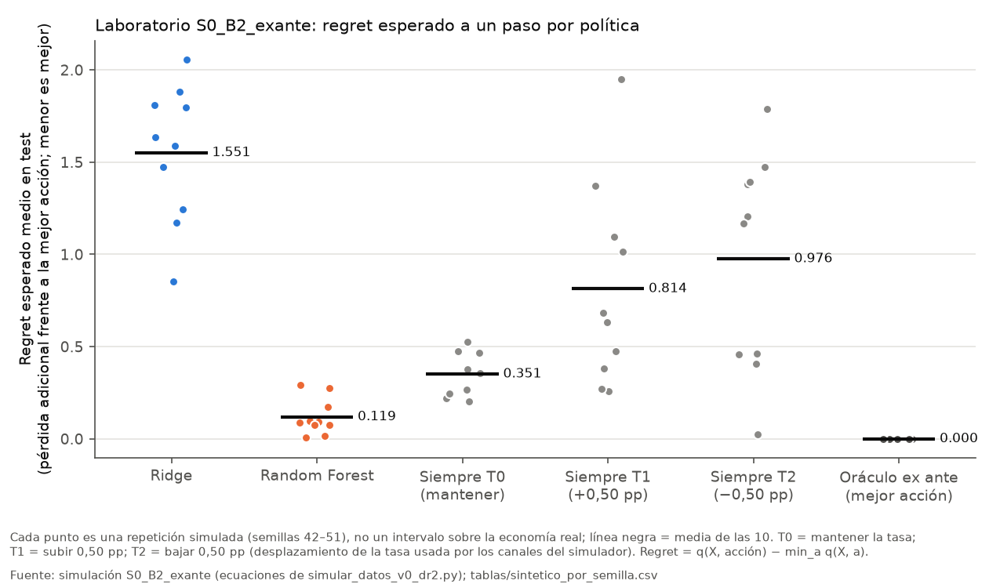
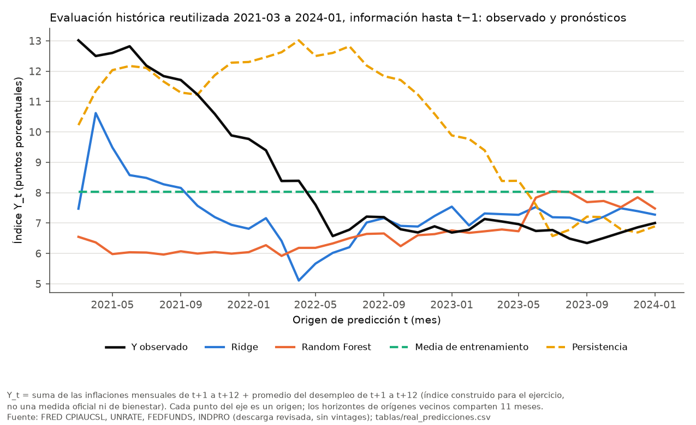
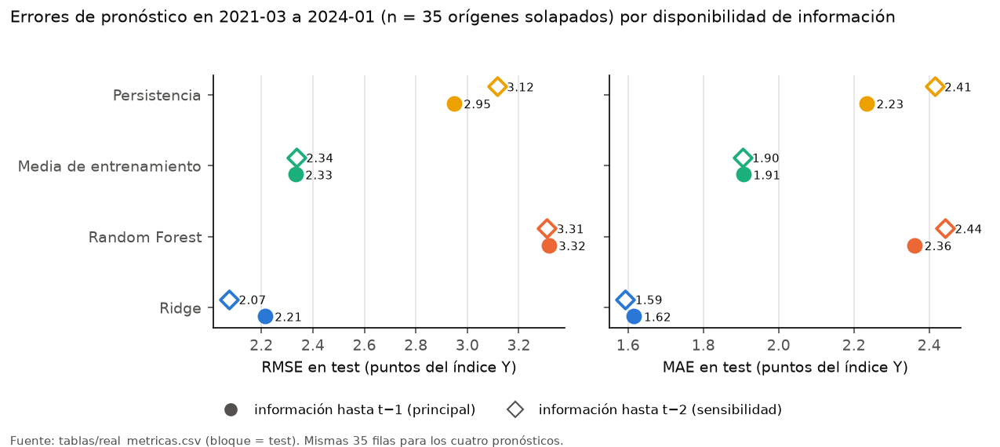

# Política monetaria y machine learning: cuándo un modelo más complejo aporta, y cuándo la evidencia no permite recomendar

**Pregunta.** ¿Qué aportan un modelo lineal (Ridge) y uno no lineal (Random Forest) a la elección de acciones de tasa en un entorno simulado y a la predicción macroeconómica con datos de EE. UU.? ¿Qué impide trasladar esas decisiones a los datos históricos?

**Resultado en una línea.** En el simulador, Random Forest elige acciones con menos pérdida adicional que mantener la tasa y que Ridge. En los datos históricos, Ridge pronostica algo mejor que una media simple, y Random Forest queda por detrás de las dos referencias simples. Ninguna de las dos ramas permite recomendar una tasa a la Reserva Federal.

Ejecución de referencia: `b3_final_20261020_101239`, con código de salida 0 y 10/10 pruebas en PASS.

---

## 1. Problema
Antes de usar un modelo para decidir hay que responder tres preguntas:
- ¿Qué información existe en el momento de la decisión?
- ¿Contra qué referencia simple se mide el modelo?
- ¿Se puede evaluar la decisión con los datos disponibles?

En los datos históricos no se observa qué habría pasado con otra decisión. Además, en el trabajo original la acción histórica se construía a partir del cambio de la tasa, que también era un predictor. Por eso el caso separa dos ramas:

| Rama | Qué evalúa | Qué no evalúa |
|---|---|---|
| **Laboratorio simulado** | Decisiones *ex ante* a un paso: se elige la acción viendo el estado de la economía, antes del choque del mes. Las ecuaciones permiten conocer la pérdida esperada de cada acción | Trayectorias completas, bienestar de largo plazo, decisiones reales |
| **Datos históricos (FRED)** | Pronóstico retrospectivo de un índice de inflación y desempleo frente a referencias simples | Recomendaciones de política ni efectos causales |

## 2. Datos
- **Simulación.** Ecuaciones del simulador original del proyecto (`src/simular_datos_v0_dr2.py`): inflación, desempleo, tasa y actividad, con un canal tasa → inflación no lineal. Hay 600 meses por repetición y 10 repeticiones (semillas 42 a 51).
  - Acciones: **T0** = mantener la tasa; **T1** = subirla 0,50 puntos porcentuales; **T2** = bajarla 0,50 pp.
  - El desplazamiento de ±0,50 pp entra en los canales de inflación, desempleo y actividad. La ecuación heredada de la tasa traslada solo ±0,05 pp al valor esperado de la tasa del mes siguiente, así que no es una réplica literal de una decisión del FOMC.
- **Históricos.** Cuatro series mensuales de FRED, en la descarga original del trabajo (revisada, sin vintages): CPIAUCSL, UNRATE, FEDFUNDS e INDPRO, de 1990-01 a 2025-01. Procedencia y huellas en `data/raw/PROCEDENCIA.md`.

## 3. Metodología
**Laboratorio.**
- La pérdida de un mes es (inflación − 2)² + (desempleo − 4,5)² + 2·(cambio de tasa decidido)². Metas y pesos son supuestos del laboratorio.
- Para cada estado y acción se calcula su pérdida **esperada** q, de forma analítica.
- El «banco central» del simulador elige con probabilidades que dependen de q. Los modelos solo ven la pérdida de la acción elegida.
- **Regret** = pérdida esperada adicional frente a la mejor acción del simulador. Menor es mejor; 0 es el óptimo.
- Se compara Ridge y RF con tres reglas fijas (siempre T0, T1 o T2) y con el óptimo.

**Históricos.**
- **Índice Y** = suma de las inflaciones mensuales de los 12 meses siguientes más el promedio del desempleo de esos 12 meses. Es un índice construido para el ejercicio, no una medida oficial ni una función de bienestar. El RMSE está en puntos de este índice, no es un porcentaje de error.
- Predictores: 12, todos fechados hasta el mes anterior al pronóstico (t−1). La sensibilidad usa t−2.
- Entrenamiento con orígenes de 1992-01 a 2020-02. Evaluación con un solo ajuste en 2021-03 → 2024-01 (35 orígenes).
- Referencias simples: la media del entrenamiento y la persistencia (el mismo índice calculado con los 12 meses anteriores).
- La validación interna purga el horizonte de 12 meses.

Detalle técnico: [`docs/NOTA_METODOLOGICA.md`](docs/NOTA_METODOLOGICA.md).

## 4. Hallazgos

### Laboratorio: regret esperado a un paso (10 repeticiones)



| Política | Regret medio | Pérdida esperada media |
|---|---|---|
| Random Forest | **0,119** | 7,284 |
| Siempre T0 (mantener) | 0,351 | 7,516 |
| Siempre T1 (+0,50 pp) | 0,814 | 7,978 |
| Siempre T2 (−0,50 pp) | 0,976 | 8,140 |
| Ridge | 1,551 | 8,716 |
| Óptimo del simulador | 0 | 7,165 |

- **RF supera a mantener y a Ridge en las 10 repeticiones.** Frente a mantener, RF reduce un **66,0 %** la pérdida adicional (regret de 0,351 a 0,119, sobre el regret de mantener). En cambio, reduce solo un **3,1 %** la pérdida total (de 7,516 a 7,284, sobre la pérdida total). La diferencia se debe a los denominadores: la mayor parte de la pérdida existe con cualquier acción.
- RF no supera a toda regla fija en toda repetición: en la semilla 49, «siempre T2» obtiene menor regret (0,023 frente a 0,093).
- En 187 de 1200 decisiones de test, RF predice valores empatados, y la regla operativa los resuelve hacia mantener. Esas filas concentran cerca del 85,5 % del regret de RF. Es un diagnóstico de esas filas; no demuestra que eliminarlas mejore una política.
- **Ridge rinde peor que mantener en las 10 repeticiones.** La selección de hiperparámetros minimiza el error predictivo factual y no garantiza minimizar la pérdida adicional de las decisiones. Este experimento no identifica la causa del mal desempeño decisional de Ridge.

### Datos históricos: pronóstico del índice Y, 2021-03 → 2024-01



| Pronóstico | RMSE con información hasta t−1 | RMSE con información hasta t−2 |
|---|---|---|
| Ridge | **2,214** | **2,075** |
| Media de entrenamiento | 2,333 | 2,336 |
| Persistencia | 2,948 | 3,116 |
| Random Forest | 3,317 | 3,309 |



- Con información hasta t−1, Ridge mejora un 5,1 % frente a la media y un 24,9 % frente a la persistencia. El orden se mantiene con información hasta t−2.
- RF tuvo el menor error en la validación interna (RMSE 1,670 frente a 1,704 de Ridge), pero en la evaluación final quedó por detrás de ambas referencias. Seleccionar con el desarrollo no garantiza ganar en otra ventana, y la causa concreta de ese cambio no está identificada.
- El resultado «Ridge gana por IPW» del trabajo original se recalcula exactamente, pero no es interpretable como valor de una política. Se conserva solo como diagnóstico ([`tablas/diagnostico_ipw_legacy.csv`](tablas/diagnostico_ipw_legacy.csv)).

## 5. Utilidad: qué decisión permite el caso
- **Conservar referencias simples** como comparador obligatorio. En datos históricos, la media del entrenamiento estuvo a 0,12 puntos del mejor modelo, y RF quedó por detrás de las dos referencias.
- **Tratar Ridge como candidato** para una validación futura con datos en tiempo real y otra ventana de evaluación, no como herramienta lista para usar.
- **No trasladar las reglas simuladas a la Fed.** La ventaja de RF en el laboratorio depende de ecuaciones conocidas y de una decisión a un paso.

## 6. Límites
- Datos revisados, no disponibles en tiempo real; la evaluación histórica reutiliza una ventana ya examinada en el trabajo original.
- 35 fechas de evaluación cuyos horizontes comparten 11 meses: no se calculan intervalos ni pruebas de significancia.
- Simulación a un paso; los resultados dependen del simulador, sus metas y sus pesos.
- Sin inferencia causal con datos reales.

## 7. Reproducción
```bash
python3 -m venv .venv && .venv/bin/pip install -r requirements.lock.txt
bash run_bloque2.sh                    # crea outputs/b2/<RUN_ID>; se detiene con código != 0 ante cualquier fallo
```
- La receta autocontenida es `run_bloque2.sh`. `run_all.sh` y `run_all_B1_original.sh` son referencia histórica de la reproducción del trabajo original (bloque 1) y no se pueden ejecutar completas desde este paquete; `run_all.sh` se usa en la prueba 6b.
- Entorno de referencia: Python 3.13.11, scikit-learn 1.9.1, pandas 3.0.6 y numpy 2.5.4, en macOS arm64.
- Una reproducción independiente con Python 3.12 y scikit-learn 1.8.0 conservó las 2400 decisiones del laboratorio y el orden de los modelos reales. Las cifras de RF varían ligeramente (`evidencia_revision_independiente/`).
- Las métricas se pueden recalcular sin reentrenar, desde `tablas/real_predicciones.csv` y `tablas/sintetico_predicciones.csv`.

## Créditos
Trabajo original: **David Bonilla, Yosua Ramírez y Luisa Perdomo**, trabajo final del curso *Tópicos en IA & Economía* (Álvaro J. Riascos Villegas), abril de 2026. David declara haber participado en la teoría, la planificación, el código y el análisis. La consolidación, el protocolo corregido y su implementación (2026-10) se hicieron con asistencia de ChatGPT (revisión y protocolo) y Claude Code (implementación y ejecución), bajo la dirección de David.

## Anexo: historia de revisión
1. **Bloque 1:** reproducción del trabajo original e inventario de versiones. Hallazgos: el tratamiento histórico estaba entre los predictores, el IPW no era interpretable y el RF real decidía por redondeo (`docs/revision/`).
2. **Bloque 2:** protocolo corregido. Simulador ex ante, oráculo de pérdida esperada, purga temporal, rama histórica solo predictiva y runner que se detiene ante fallos ([`docs/CAMBIOS_B2.md`](docs/CAMBIOS_B2.md), [`docs/PROTOCOLO.md`](docs/PROTOCOLO.md)).
3. **Bloque 3:** revisión formal y correcciones acotadas, sin cambio de cifras ([`docs/revision/VEREDICTO_Y_PROMPT_CIERRE.md`](docs/revision/VEREDICTO_Y_PROMPT_CIERRE.md)). El borrador previo se conserva en [`README_BORRADOR.md`](README_BORRADOR.md).
